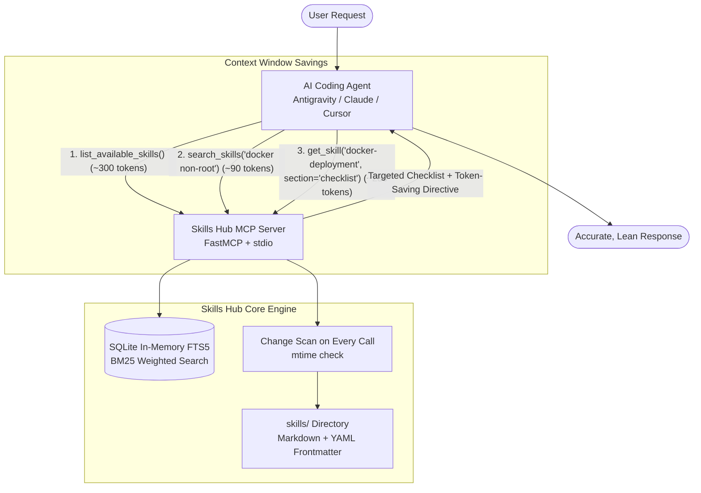

# Skills Hub MCP Server 🧠⚡

[](https://modelcontextprotocol.io/)
[](https://www.python.org/)
[](https://github.com/jlowin/fastmcp)
[](https://opensource.org/licenses/MIT)
[](https://github.com/Thawatchai-Yodyeam/MCP-hub-Skill/pulls)

> **Lightweight On-Demand Agent Skills Management for AI Coding Assistants**  
> Eliminate **System Prompt Bloat & Context Window Saturation** through **Progressive On-Demand Retrieval**.

---

## 🎯 The Problem: Context Window Bloat

Modern AI coding agents (Antigravity, Claude Code, Cursor, Windsurf, Cline) rely heavily on specialized skills, runbooks, and checklists (e.g., Docker security, SQL optimization, API standards, testing protocols).

However, preloading dozens of skill documents into the system prompt causes severe problems:
- ❌ **Token Saturation**: Ingests 10,000 to 50,000+ tokens before the conversation even begins.
- ❌ **Attention Drift & Amnesia**: Flooding the context window causes LLMs to lose track of earlier conversation turns and reasoning history.
- ❌ **High Latency & Costs**: Inflates token consumption on every single agent interaction.

---

## 💡 The Solution: Progressive On-Demand Retrieval

**Skills Hub MCP** changes the paradigm: instead of stuffing all skills into the prompt upfront, skills are stored locally as Markdown files and retrieved **only when needed, on-demand**:

1. **Lightweight Overview**: `list_available_skills` returns a compact index (about 300 tokens for the 6 starter skills, about 150 with `summary_only=True`). Above 25 skills it automatically collapses to one line per category.
2. **Fast Search**: In-memory **SQLite FTS5 (Full-Text Search)** with **BM25 ranking** — about 0.5 ms per query on the starter skills, including the change scan. Skills matching every keyword are listed first, followed by partial matches. A substring fallback covers languages written without spaces between words, such as Thai.
3. **Section-Targeted Retrieval**: Fetch only the section you need (`get_skill(name, section="checklist")`) instead of the whole document. Savings grow with skill length: the starter skills are short, so a checklist response is only about 20% smaller than the full skill, while long runbooks save far more.
4. **Token-Saving Directive**: Every `get_skill` response starts with a short directive (about 110 tokens) asking the agent not to echo the document back. This only saves output tokens — the retrieved text still enters the context, which is why section-targeted retrieval matters most.
5. **Hot-Reloading**: Every tool call re-scans the `skills/` folder and re-indexes only files that were added, changed, or deleted. No restart and no background watcher needed.

### Where Skills Hub Fits

Claude Code already has native [Agent Skills](https://code.claude.com/docs/en/skills) with the same progressive loading built in. Skills Hub's main value is **one skill library shared by every agent** (Claude Code, Cursor, Antigravity/Gemini, Cline, Windsurf), kept as plain Markdown in one place.

Agents only use the hub when they decide to call it, so the [directive files](#-universal-agent-directives) matter: they tell the agent to search the hub before working in a specialized domain.

---

## 🏗️ Architecture



---

## 📁 Repository Structure

```
MCP-hub-Skill/
├── server.py                   # FastMCP Server (stdio) with SQLite FTS5 Engine
├── config.json                 # Configuration (skills directory)
├── mcp_config_snippet.json     # Example MCP client config (edit the paths for your machine)
├── AGENTS.md                   # Universal Directive for all AI Agents
├── CLAUDE.md                   # Directive for Claude Code
├── GEMINI.md                   # Directive for Antigravity / Gemini
├── .cursorrules                # Directive for Cursor IDE
├── pyproject.toml              # Python project metadata
├── requirements.txt            # Dependencies (fastmcp, pyyaml)
├── LICENSE                     # MIT License
│
├── skills/                     # Default Starter Skills
│   ├── web-development/api-design.md           (REST API Best Practices)
│   ├── devops/docker-deployment.md             (Production Docker Checklist)
│   ├── performance/sql-optimization.md         (SQL Tuning & Indexing)
│   ├── code-review/security-audit.md           (OWASP Security Review)
│   ├── git-workflow/conventional-commits.md    (Semantic Commit Rules)
│   └── testing/pytest-testing.md               (Pytest Unit Testing Standards)
│
└── scripts/
    └── import_skills.py        # Utility to import local agent skills into the hub
```

---

## 🔌 MCP Tools

| Tool | Description | Parameters |
| :--- | :--- | :--- |
| `list_available_skills` | Returns a compact overview of available skills grouped by category. Automatically summarizes when skill count exceeds 25. | `category` (optional), `limit` (default: 30), `summary_only` (default: false) |
| `search_skills` | Fast BM25 full-text search across titles, descriptions, tags, and content. Returns ranked results with section lists. | `query` (required), `limit` (default: 5) |
| `get_skill` | Retrieves complete skill instructions or extracts targeted sub-sections (e.g., `checklist`, `anti-patterns`) with token directives. | `skill_name` (required), `section` (optional) |
| `add_or_update_skill` | Creates a skill, or overwrites the existing one with the same name and category, then re-indexes it. Names and categories are limited to letters, digits, `_` and `-`, which blocks path traversal. | `name`, `description`, `content`, `category`, `tags` |

---

## 🚀 Quickstart & Setup

### 1. Prerequisites
- Python 3.10 or higher (Python 3.14 recommended)
- `uv` or `pip` package manager

### 2. Installation
Clone the repository and install dependencies:

```bash
git clone https://github.com/Thawatchai-Yodyeam/MCP-hub-Skill.git
cd MCP-hub-Skill
pip install -r requirements.txt
```

---

## ⚙️ Connecting to MCP Clients

### Antigravity / Gemini
Add the following to your `~/.gemini/config/mcp_config.json`:

```json
{
  "mcpServers": {
    "skills-hub": {
      "command": "python",
      "args": ["/path/to/MCP-hub-Skill/server.py"],
      "env": {
        "PYTHONUNBUFFERED": "1",
        "SKILLS_DIR": "/path/to/MCP-hub-Skill/skills"
      }
    }
  }
}
```

### Claude Code (Anthropic)
Add to your project's `.mcp.json` or global Claude configuration:

```json
{
  "mcpServers": {
    "skills-hub": {
      "command": "python",
      "args": ["/path/to/MCP-hub-Skill/server.py"]
    }
  }
}
```

### Cursor IDE
Navigate to **Cursor Settings > Features > MCP > Add New MCP Server**:
- **Type**: `command`
- **Name**: `skills-hub`
- **Command**: `python /path/to/MCP-hub-Skill/server.py`

---

## ✍️ Adding Custom Skills

### Method 1: Create a Markdown File (Recommended)
Place a `.md` file inside `skills/<category>/<skill-name>.md` with YAML frontmatter:

```markdown
---
name: k8s-production
category: devops
description: Production Kubernetes deployment checklist and resource limits.
tags: [kubernetes, k8s, devops, containers]
---

# Kubernetes Production Deployment Guide

## Checklist
- [ ] Define explicit CPU and Memory requests and limits for all containers.
- [ ] Implement liveness and readiness probes with appropriate initial delays.
- [ ] Configure PodDisruptionBudgets (PDB) for high availability during node drains.
- [ ] Run containers as non-root with read-only root filesystems where possible.

## Anti-patterns
- Using `latest` image tags in production deployment manifests.
- Storing secrets in plain ConfigMaps instead of Secret resources or external vaults.
```

*Skills Hub detects file changes and re-indexes them instantly — zero server restart required!*

### Method 2: Via AI Agent Tool Call
Any connected AI agent can create skills programmatically:

```python
add_or_update_skill(
    name="graphql-best-practices",
    description="GraphQL schema design, query complexity analysis, and dataloader.",
    category="web-development",
    tags="graphql, api, backend",
    content="""# GraphQL Best Practices
## Checklist
- [ ] Use DataLoader to batch queries and eliminate N+1 issues.
- [ ] Implement query complexity and depth limiting to prevent DoS.
"""
)
```

### Method 3: Import Existing Machine Skills
If you have existing skills in your local environment, run the bundled import script:

```bash
python scripts/import_skills.py
# Or specify a custom folder:
python scripts/import_skills.py "/path/to/existing/skills"
```

---

## 🤖 Universal Agent Directives

To ensure your AI assistant retrieves skills on demand rather than asking you to dump guidelines into the chat, place the included directives in your workspace root:

| File | Target AI / Tool | Highlights |
| :--- | :--- | :--- |
| **`AGENTS.md`** ⭐ | **Antigravity, Cline, Roo Code, Open Agents** | Vendor-neutral universal standard. First-class citizen in modern agentic tools. |
| **`CLAUDE.md`** | **Claude Code (Anthropic)** | Standard configuration for Claude Code CLI. |
| **`GEMINI.md`** | **Antigravity / Gemini** | Same rules as `AGENTS.md`, for tools that read `GEMINI.md`. |
| **`.cursorrules`** | **Cursor IDE** | Automatically triggers for Cursor Composer and Chat. |

---

## 📊 Token Usage (Measured)

Measured on the 6 bundled starter skills. Tokens are estimated at ~4 characters per token, so treat them as approximate. `get_skill` figures include the ~110-token directive.

| Operation | Tokens (≈) |
| :--- | :--- |
| Preloading all 6 skills into the system prompt | ~1,550 |
| `list_available_skills()` | ~300 |
| `list_available_skills(summary_only=True)` | ~150 |
| `search_skills('docker non-root')` | ~90 |
| `get_skill('docker-deployment')` (full skill) | ~355 |
| `get_skill('docker-deployment', section='checklist')` | ~280 |
| MCP tool definitions (loaded once per session) | ~650 |

Preloading costs grow with every skill you add. The hub's overview stays small (one line per category above 25 skills), and search and retrieval only cost tokens for the skills you actually use. With just a few short skills, preloading can be cheaper than the hub's tool definitions; the hub pays off as the library grows.

---

## 🛡️ Hardening & Thread Safety

- **Thread-Safe In-Memory SQLite**: All index reads and writes go through a single `threading.Lock()`, so concurrent tool calls never see a half-updated index.
- **Path Traversal Protection**: Skill names and categories are restricted to letters, digits, `_` and `-`, so they cannot escape the skills directory (`../../`).
- **Safe Frontmatter**: Skills written by the server or the importer use a YAML serializer, so descriptions containing `:`, `#`, or line breaks stay valid.
- **Hidden Directory Filtering**: Automatically ignores `.git`, `.obsidian`, `.vscode`, and hidden files.
- **Name Collision Disambiguation**: Duplicate skill names are namespaced as `category/skill-name` (or by the file's path if that is also taken).

---

## 📄 License

Distributed under the [MIT License](./LICENSE). Feel free to use, modify, and distribute in commercial or open-source projects.
