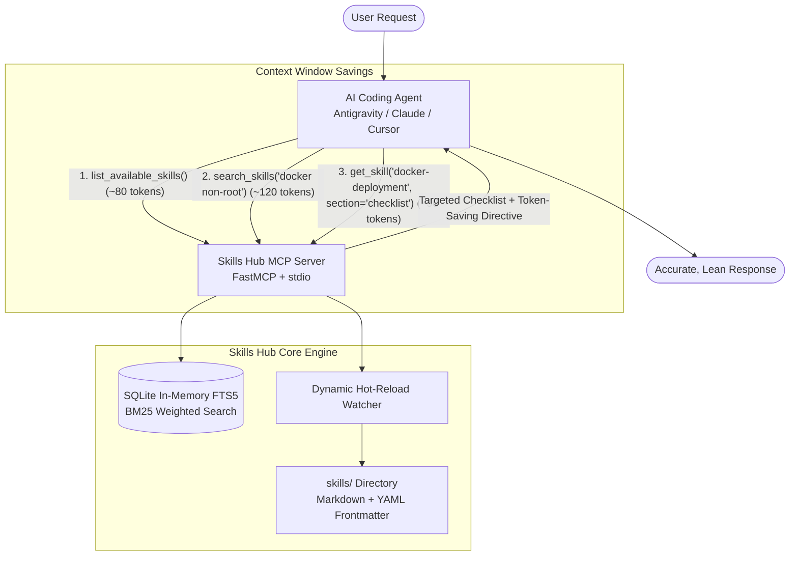

# Skills Hub MCP Server 🧠⚡

[](https://modelcontextprotocol.io/)
[](https://www.python.org/)
[](https://github.com/jlowin/fastmcp)
[](https://opensource.org/licenses/MIT)
[](https://github.com/Thawatchai-Yodyeam/MCP-hub-Skill/pulls)

> **Lightweight On-Demand Agent Skills Management for AI Coding Assistants**  
> Eliminate **System Prompt Bloat & Context Window Saturation** through **Progressive On-Demand Retrieval**.

---

## 🎯 The Problem: Context Window Bloat

Modern AI coding agents (Antigravity, Claude Code, Cursor, Windsurf, Cline) rely heavily on specialized skills, runbooks, and checklists (e.g., Docker security, SQL optimization, API standards, testing protocols).

However, preloading dozens of skill documents into the system prompt causes severe problems:
- ❌ **Token Saturation**: Ingests 10,000 to 50,000+ tokens before the conversation even begins.
- ❌ **Attention Drift & Amnesia**: Flooding the context window causes LLMs to lose track of earlier conversation turns and reasoning history.
- ❌ **High Latency & Costs**: Inflates token consumption on every single agent interaction.

---

## 💡 The Solution: Progressive On-Demand Retrieval

**Skills Hub MCP** changes the paradigm: instead of stuffing all skills into the prompt upfront, skills are stored locally as Markdown files and retrieved **only when needed, on-demand**:

1. **Lightweight Overview**: AI inspects a compact category summary (`list_available_skills`) costing less than **100 tokens**.
2. **Sub-millisecond Search**: Powered by in-memory **SQLite FTS5 (Full-Text Search)** and **BM25 ranking**, searching keywords and tags in `< 5ms`.
3. **Section-Targeted Retrieval**: Fetch only actionable sections (`get_skill(name, section="checklist")`) rather than 300 lines of prose — **reducing token consumption by 85–95%**.
4. **Built-in Token Directives**: Every retrieved skill automatically injects a strict directive instructing the AI to summarize actionable steps into its scratchpad instead of echoing the full document back to the user.
5. **Dynamic Hot-Reloading**: Drop new Markdown files into the `skills/` folder; the server instantly detects and re-indexes them without requiring a restart.

---

## 🏗️ Architecture



---

## 📁 Repository Structure

```
MCP-hub-Skill/
├── server.py                   # FastMCP Server (stdio) with SQLite FTS5 Engine
├── config.json                 # Configuration (skills path, search limits)
├── mcp_config_snippet.json     # Ready-to-use config snippet for MCP clients
├── AGENTS.md                   # Universal Directive for all AI Agents
├── CLAUDE.md                   # Directive for Claude Code
├── .cursorrules                # Directive for Cursor IDE
├── pyproject.toml              # Python project metadata
├── requirements.txt            # Dependencies (fastmcp, pyyaml)
│
├── skills/                     # Default Starter Skills
│   ├── web-development/api-design.md           (REST API Best Practices)
│   ├── devops/docker-deployment.md             (Production Docker Checklist)
│   ├── performance/sql-optimization.md         (SQL Tuning & Indexing)
│   ├── code-review/security-audit.md           (OWASP Security Review)
│   ├── git-workflow/conventional-commits.md    (Semantic Commit Rules)
│   └── testing/pytest-testing.md               (Pytest Unit Testing Standards)
│
└── scripts/
    └── import_skills.py        # Utility to import local agent skills into the hub
```

---

## 🔌 MCP Tools

| Tool | Description | Parameters |
| :--- | :--- | :--- |
| `list_available_skills` | Returns a compact overview of available skills grouped by category. Automatically summarizes when skill count exceeds 25. | `category` (optional), `limit` (default: 30), `summary_only` (default: false) |
| `search_skills` | Fast BM25 full-text search across titles, descriptions, tags, and content. Returns ranked results with section lists. | `query` (required), `limit` (default: 5) |
| `get_skill` | Retrieves complete skill instructions or extracts targeted sub-sections (e.g., `checklist`, `anti-patterns`) with token directives. | `skill_name` (required), `section` (optional) |
| `add_or_update_skill` | Programmatically creates or updates a skill in the repository with automatic indexing and path traversal protection. | `name`, `description`, `content`, `category`, `tags` |

---

## 🚀 Quickstart & Setup

### 1. Prerequisites
- Python 3.10 or higher (Python 3.14 recommended)
- `uv` or `pip` package manager

### 2. Installation
Clone the repository and install dependencies:

```bash
git clone https://github.com/Thawatchai-Yodyeam/MCP-hub-Skill.git
cd MCP-hub-Skill
pip install -r requirements.txt
```

---

## ⚙️ Connecting to MCP Clients

### Antigravity / Gemini
Add the following to your `~/.gemini/config/mcp_config.json`:

```json
{
  "mcpServers": {
    "skills-hub": {
      "command": "python",
      "args": ["/path/to/MCP-hub-Skill/server.py"],
      "env": {
        "PYTHONUNBUFFERED": "1",
        "SKILLS_DIR": "/path/to/MCP-hub-Skill/skills"
      }
    }
  }
}
```

### Claude Code (Anthropic)
Add to your project's `.mcp.json` or global Claude configuration:

```json
{
  "mcpServers": {
    "skills-hub": {
      "command": "python",
      "args": ["/path/to/MCP-hub-Skill/server.py"]
    }
  }
}
```

### Cursor IDE
Navigate to **Cursor Settings > Features > MCP > Add New MCP Server**:
- **Type**: `command`
- **Name**: `skills-hub`
- **Command**: `python /path/to/MCP-hub-Skill/server.py`

---

## ✍️ Adding Custom Skills

### Method 1: Create a Markdown File (Recommended)
Place a `.md` file inside `skills/<category>/<skill-name>.md` with YAML frontmatter:

```markdown
---
name: k8s-production
category: devops
description: Production Kubernetes deployment checklist and resource limits.
tags: [kubernetes, k8s, devops, containers]
---

# Kubernetes Production Deployment Guide

## Checklist
- [ ] Define explicit CPU and Memory requests and limits for all containers.
- [ ] Implement liveness and readiness probes with appropriate initial delays.
- [ ] Configure PodDisruptionBudgets (PDB) for high availability during node drains.
- [ ] Run containers as non-root with read-only root filesystems where possible.

## Anti-patterns
- Using `latest` image tags in production deployment manifests.
- Storing secrets in plain ConfigMaps instead of Secret resources or external vaults.
```

*Skills Hub detects file changes and re-indexes them instantly — zero server restart required!*

### Method 2: Via AI Agent Tool Call
Any connected AI agent can create skills programmatically:

```python
add_or_update_skill(
    name="graphql-best-practices",
    description="GraphQL schema design, query complexity analysis, and dataloader.",
    category="web-development",
    tags="graphql, api, backend",
    content="""# GraphQL Best Practices
## Checklist
- [ ] Use DataLoader to batch queries and eliminate N+1 issues.
- [ ] Implement query complexity and depth limiting to prevent DoS.
"""
)
```

### Method 3: Import Existing Machine Skills
If you have existing skills in your local environment, run the bundled import script:

```bash
python scripts/import_skills.py
# Or specify a custom folder:
python scripts/import_skills.py "/path/to/existing/skills"
```

---

## 🤖 Universal Agent Directives

To ensure your AI assistant retrieves skills on demand rather than asking you to dump guidelines into the chat, place the included directives in your workspace root:

| File | Target AI / Tool | Highlights |
| :--- | :--- | :--- |
| **`AGENTS.md`** ⭐ | **Antigravity, Cline, Roo Code, Open Agents** | Vendor-neutral universal standard. First-class citizen in modern agentic tools. |
| **`CLAUDE.md`** | **Claude Code (Anthropic)** | Standard configuration for Claude Code CLI. |
| **`.cursorrules`** | **Cursor IDE** | Automatically triggers for Cursor Composer and Chat. |

---

## 📊 Token Savings Benchmark

| Operation | Traditional System Prompt Injection | Skills Hub Progressive Retrieval | Token Reduction |
| :--- | :--- | :--- | :--- |
| **Session Initialization** | 15,000 – 45,000 tokens (All skills preloaded) | **~80 tokens** (`list_available_skills`) | **~99.5% saved** |
| **Skill Search** | N/A (Manual searching required) | **~120 tokens** (`search_skills`) | **Fast & Focused** |
| **Applying a Rule/Checklist** | 1,200 – 3,500 tokens (Full doc copy) | **~90 tokens** (`get_skill(..., section='checklist')`) | **~95% saved** |

---

## 🛡️ Hardening & Thread Safety

- **Thread-Safe In-Memory SQLite**: Protected by `threading.Lock()` mutex to guarantee zero race conditions or database locks during concurrent tool calls.
- **Path Traversal Protection**: File inputs are sanitized using strict alphanumeric regex filters, preventing directory escape attacks (`../../`).
- **Hidden Directory Filtering**: Automatically ignores `.git`, `.obsidian`, `.vscode`, and hidden files.
- **Name Collision Disambiguation**: Gracefully namespaces duplicate skill names across multiple directories (`category/skill-name`).

---

## 📄 License

Distributed under the [MIT License](./LICENSE). Feel free to use, modify, and distribute in commercial or open-source projects.
